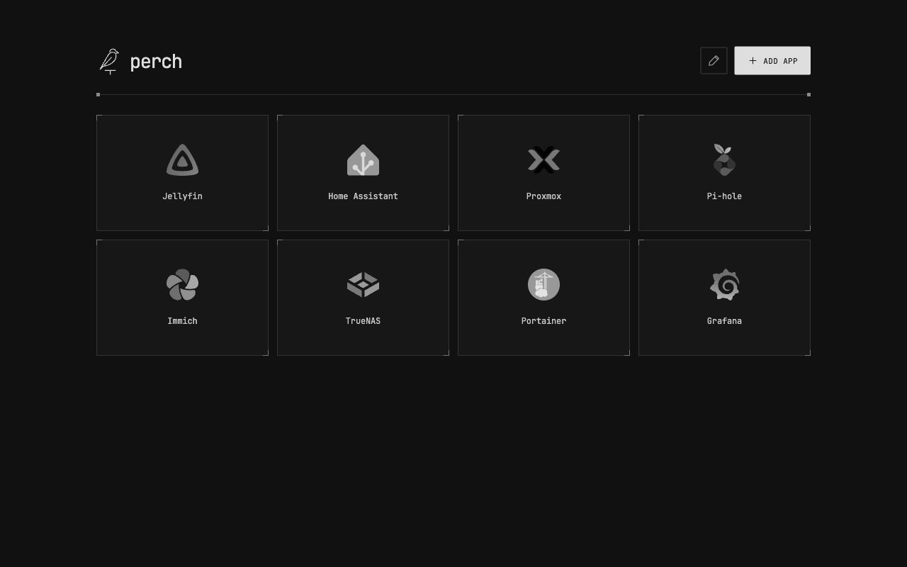

# Perch

A minimal homelab dashboard built with Rust and [Topcoat](https://github.com/tokio-rs/topcoat). Your apps, their logos, and nothing in the way.



*Preview with example services. New installations start empty.*

- **One binary.** The interface, icons and fonts are embedded. No database, Node runtime or frontend build step.
- **Your apps, your order.** Add service links, choose logos, and arrange tiles with drag handles or keyboard-accessible buttons.
- **Automatic logos.** Resolve favicons directly from your services, or choose a bundled icon, image URL or uploaded image.
- **A single data file.** Your links and their order live in a local JSON file.

## Install on Proxmox VE

Follow the [Proxmox VE installation guide](docs/proxmox.md) to create a managed container. The installed dashboard uses **HTTP port 80**: open **`http://<container-ip>/`**, with no port number needed in the address.

## Run locally from source

Build with **Rust 1.98 or newer**:

```sh
git clone https://github.com/olivecarney/perch.git
cd perch
cargo build --release --locked
./target/release/perch
```

For this manually launched build, open **http://127.0.0.1:3000** and select **Add app**. Local builds use port 3000; the packaged Proxmox service uses port 80. The built binary runs without the source tree or `public/` directory; build for your server's OS and CPU architecture.

To expose this manually launched build to other devices on your trusted LAN at `http://<server-ip>:3000/`:

```sh
HOST=0.0.0.0 PORT=3000 PERCH_DATA=/path/to/perch/apps.json ./target/release/perch
```

Replace the data path with a writable location. See [installation and configuration](docs/installation.md) for Docker, configuration defaults and deployment details, or use the [Proxmox VE guide](docs/proxmox.md).

**Perch has no authentication or built-in TLS.** Anyone who can reach it can read and change its shortcuts. Use a trusted private network or an authenticated HTTPS reverse proxy.

## Documentation

| Guide | What you can do |
| --- | --- |
| [User guide](docs/user-guide.md) | Add, edit and arrange apps; choose logos |
| [Installation and configuration](docs/installation.md) | Build, configure or run with Docker |
| [Proxmox VE](docs/proxmox.md) | Install an LXC, update, troubleshoot and uninstall |
| [Backups and troubleshooting](docs/operations.md) | Protect your collection and diagnose problems |
| [Contributing](CONTRIBUTING.md) | Set up development, run checks and submit changes |
| [Architecture](docs/architecture.md) | Understand the server, browser and storage |
| [HTTP API](docs/api.md) | Read and manage shortcuts programmatically |
| [Releases](docs/releases.md) | Build and publish release assets |

## License and attribution

Perch is [MIT licensed](LICENSE). Service icons are from [homarr-labs/dashboard-icons](https://github.com/homarr-labs/dashboard-icons), and the bundled [JetBrains Mono](https://github.com/JetBrains/JetBrainsMono) font uses the SIL Open Font License. See [THIRD_PARTY.md](THIRD_PARTY.md) and the included asset licenses. Product names and marks belong to their respective owners.
